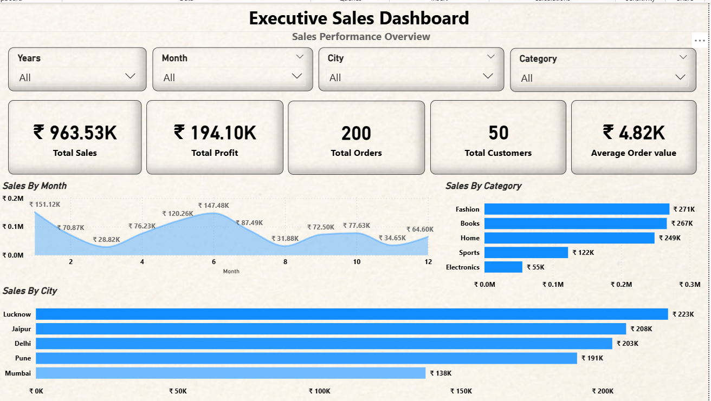
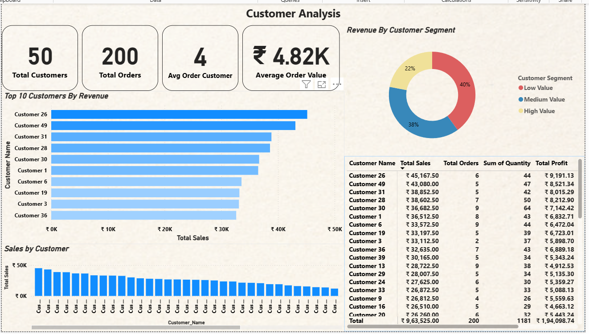

# E-Commerce Sales Dashboard --- Power BI

## Project Overview

The **E-Commerce Sales Dashboard** is an interactive Power BI project
designed to analyze sales performance, profitability, product and
category performance, and customer behavior. It presents business
metrics through KPI cards, charts, customer tables, and category
contribution visuals to help users explore the data and identify useful
business insights.

## Project Objectives

-   Monitor key sales and profitability KPIs.
-   Compare revenue, profit, and quantity sold across product
    categories.
-   Identify top-performing products and customers.
-   Understand customer value segments and ordering behavior.
-   Present business data in a clear, interactive dashboard.

## Tools & Skills

-   **Power BI Desktop** --- dashboard development and visualization
-   **DAX** --- KPI and analytical measures
-   **Power Query** --- data preparation and transformation
-   **Data Modeling** --- relationships between customers, orders,
    products, categories, and order details
-   **Data Visualization** --- KPI cards, bar charts, donut charts, and
    tables
-   **Business Analysis** --- sales, profit, product, category, and
    customer analysis

## Dashboard Pages

### 1. Executive Overview

The overview page provides a high-level summary of business performance,
including key metrics such as total sales, total profit, total orders,
total customers, and average order value. It also helps users explore
sales and profit trends and compare performance across available
business dimensions.



### 2. Product & Category Analysis

This page focuses on product and category performance. It includes:

-   Quantity sold by category
-   Revenue by category
-   Profit by category
-   Category contribution percentage
-   Top 10 products by sales

**Examples of observations from the dashboard:** - Fashion has the
highest category revenue, at approximately **₹270.55K**. - Books has the
highest quantity sold, at **306 units**. - Electronics has the lowest
category revenue, at approximately **₹55.38K**. - Fashion contributes
approximately **28.08%** of category revenue.


### 3. Customer Analysis

This page explores customer purchasing patterns and customer-level
performance. It includes:

-   Total customers and total orders
-   Average orders per customer
-   Average order value
-   Top 10 customers by revenue
-   Revenue by customer segment
-   Customer-level sales, orders, quantity, and profit details

**Examples of observations from the dashboard:** - The dashboard reports
**50 customers** and **200 orders**. - Average orders per customer is
**4**. - Average order value is approximately **₹4.82K**. - Customer
revenue segments are approximately **40% Low Value, 38% Medium Value,
and 22% High Value**.



## Data Model

The dashboard uses a relational model connecting customer and product
information with transaction data. The main tables include:

-   **Customers**
-   **Orders**
-   **Products**
-   **Categories**
-   **Order Details**

The model supports analysis of sales, profit, quantity, products,
categories, and customer performance. A date table is used for
date-based analysis where applicable.

## Key Metrics

-   **Total Sales** --- sales value across transactions
-   **Total Profit** --- profit generated from sales
-   **Total Orders** --- number of orders
-   **Total Customers** --- number of customers represented in the
    dashboard
-   **Average Order Value (AOV)** --- average sales value per order
-   **Quantity Sold** --- units sold
-   **Category Contribution %** --- each category's share of total
    category revenue

## Key Takeaways

-   Fashion leads category revenue and contributes the largest share in
    the category contribution chart.
-   Books leads the categories in quantity sold.
-   Electronics is the lowest-revenue category in the displayed category
    comparison.
-   Customer-level ranking makes it easier to identify high-revenue
    customers.
-   Customer segmentation provides a quick view of the distribution
    across Low, Medium, and High Value groups.

## Repository Structure

Keep the screenshots in a folder named `screenshots` and use these
filenames, or update the image paths below to match your actual
filenames.

``` text
E-Commerce-Sales-Dashboard/
├── README.md
├── screenshots/
│   ├── page-1-executive-overview.png
│   ├── page-2-product-category-analysis.png
│   └── page-3-customer-analysis.png
└── E-Commerce-Sales-Dashboard.pbix
```

## How to Use

1.  Download or clone this repository.
2.  Open the `.pbix` file in Power BI Desktop.
3.  Use the dashboard visuals and available filters/slicers to explore
    performance.
4.  Select categories, products, customers, or dates where interactive
    filtering is available.

## Skills Demonstrated

Power BI, DAX, Power Query, data modeling, data transformation, KPI
reporting, data visualization, sales analysis, profitability analysis,
product analysis, category analysis, and customer analysis.

------------------------------------------------------------------------

**Author:** Mohd Jamal\
**Role:** Aspiring Data Analyst
